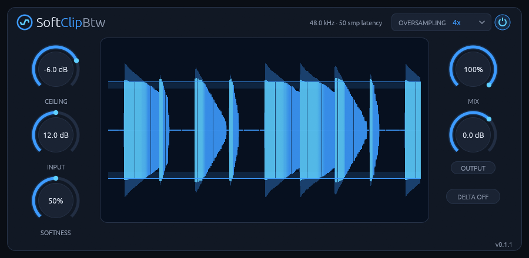

# SoftClipBtw

**A soft clipper for Linux with 2x to 16x oversampling, AUTO GAIN and a live scope.**
CLAP and VST3 for Linux.



SoftClipBtw shapes every sample instantly so the signal stops at a ceiling you set. There is no
attack, release or lookahead: INPUT drives the signal into the ceiling, CEILING sets where it stops,
and SOFTNESS rounds the corner from a hard clip to a warm, saturating bend. Put it on drums to
shave transients, on a bus for loudness, or on a single sound for a harder or rounder edge.

It runs natively on Linux, with no network access and no telemetry.

**[Read the manual](manual.md)** for every control and how to use it.

## Features

- **Adjustable knee:** from a hard clip to a bend that starts at zero level.
- **Oversampling:** Off, 2x, 4x, 8x or 16x. Aliasing of a 7 kHz sine driven 18 dB into a hard clip at 48 kHz: -11.6 dB off, -43.0 dB at 4x, -59.4 dB at 16x.
- **AUTO GAIN:** driving it harder changes the clipping, not the loudness.
- **MIX and DELTA:** parallel clipping, and listening to only what the plugin adds.
- **Live scope:** input and output peaks of the last two seconds, with the ceiling drawn across.
- **Cheap:** about 0.05% to 1.3% of one core, Off to 16x (stereo drums at 48 kHz, i7-14700K).

## Install

Download the latest version from the [Releases page](https://github.com/rmnhofma/SoftClipBtw-release/releases),
or with these commands:

```bash
curl -LO https://github.com/rmnhofma/SoftClipBtw-release/releases/download/v0.1.5/SoftClipBtw-0.1.5-linux-x86_64.tar.gz
curl -LO https://github.com/rmnhofma/SoftClipBtw-release/releases/download/v0.1.5/SoftClipBtw-0.1.5-linux-x86_64.tar.gz.sha256
sha256sum -c SoftClipBtw-0.1.5-linux-x86_64.tar.gz.sha256 && tar xzf SoftClipBtw-0.1.5-linux-x86_64.tar.gz
cd SoftClipBtw-0.1.5-linux-x86_64
```

Install for your user:

```bash
mkdir -p ~/.clap ~/.vst3
rm -f ~/.clap/SoftClipBtw.clap && cp SoftClipBtw.clap ~/.clap/
rm -rf ~/.vst3/SoftClipBtw.vst3 && cp -r SoftClipBtw.vst3 ~/.vst3/
```

Or for all users:

```bash
sudo mkdir -p /usr/lib/clap /usr/lib/vst3
sudo rm -f /usr/lib/clap/SoftClipBtw.clap && sudo cp SoftClipBtw.clap /usr/lib/clap/
sudo rm -rf /usr/lib/vst3/SoftClipBtw.vst3 && sudo cp -r SoftClipBtw.vst3 /usr/lib/vst3/
```

Removing the old copy first avoids overwriting a file a running host has loaded. Then rescan plugins
in your DAW.

To uninstall:

```bash
rm -rf ~/.clap/SoftClipBtw.clap ~/.vst3/SoftClipBtw.vst3
```

## Requirements

- Linux x86-64 with glibc 2.31 or newer (Ubuntu 20.04, Debian 11, Fedora 32 and newer)
- A CLAP or VST3 host
- X11 or XWayland, and a Vulkan driver for the editor

Releases contain the CLAP and VST3 plugins only.

## License

MIT, see [LICENSE](LICENSE). The licenses of the third-party code in the binaries are in
`THIRD-PARTY-LICENSES.txt` in each release archive.

VST is a registered trademark of Steinberg Media Technologies
GmbH. CLAP is an open standard by the free-audio project. SoftClipBtw is an
independent project. It isn't affiliated with or endorsed by Steinberg or by
GVST, whose GClip inspired the effect.
