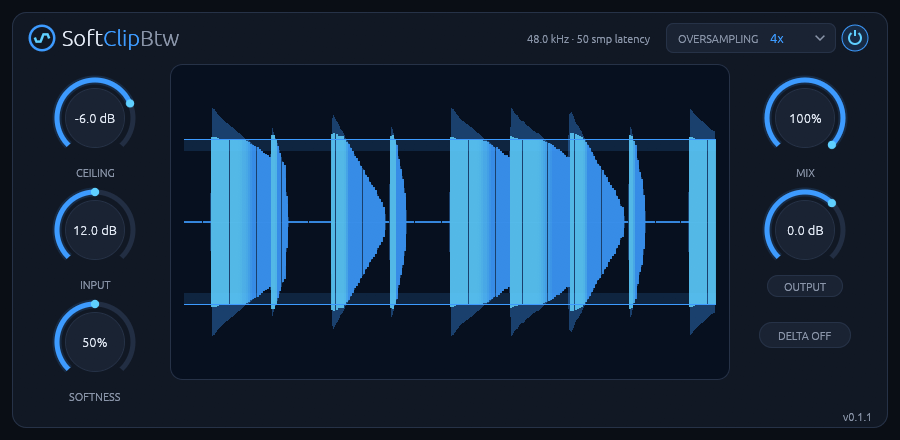
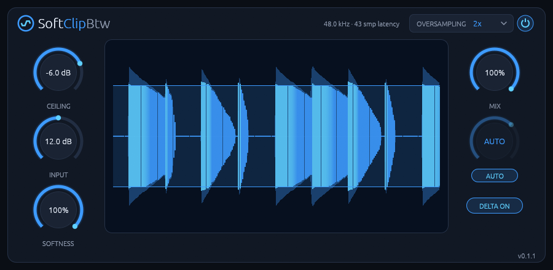
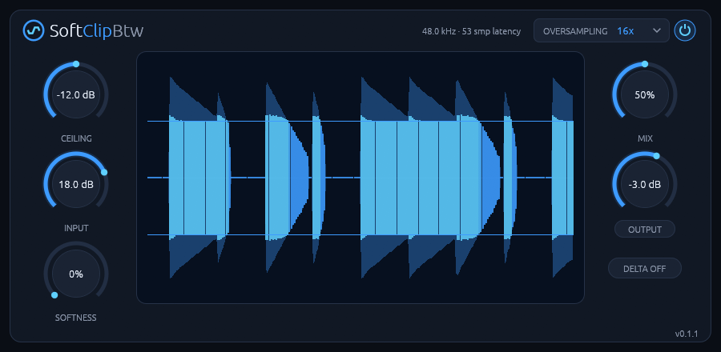

# SoftClipBtw manual

> **Discontinued** since 7 Nov 2026: SoftClipBtw gets no new releases. v0.1.5, the last one, stays
> here to download and keeps working.

**A soft clipper for Linux with 2x to 16x oversampling, AUTO GAIN and a live scope.**

Version 0.1.5. To install it, see the [README](README.md).

## Getting started

1. Put SoftClipBtw on a drum bus or a single sound.
2. Turn up INPUT until the scope shows the peaks reaching the ceiling line.
3. Turn on **AUTO** under the OUTPUT knob, so you can compare by sound rather than by level.
4. Set SOFTNESS by ear: down for a harder edge, up for a rounder one.

## The controls

| Control | Range | Default | What it does |
| --- | --- | --- | --- |
| **Power switch** (top right) | On / Off | On | Crossfades to the unprocessed signal over 20 ms, delayed to line up with the processed one. |
| **Oversampling** (top right) | Off, 2x, 4x, 8x, 16x | 2x | Runs the clipper at a higher sample rate. Higher modes alias less and cost more CPU and, from 2x, 43 to 53 samples of latency. |
| **Input** | 0 to +24 dB | 0 dB | Gain into the clipper. The scope shows the input with this gain applied. |
| **Ceiling** | -24 to 0 dB | 0 dB | The level the clipper holds the signal to. |
| **Softness** | 0 to 100% | 50% | Width of the knee. At 0% a hard clip; at 100% it starts bending at zero level. |
| **Output** | -24 to +12 dB | 0 dB | Output level. Dimmed and unused while AUTO is on. |
| **AUTO** (pill under Output) | On / Off | Off | Turns the output down by INPUT, instead of using the OUTPUT knob. |
| **Delta** (pill under Output) | On / Off | Off | Plays only the difference between the processed and the dry signal. |
| **Mix** | 0 to 100% | 100% | Dry/wet balance. |

**Mouse:** drag a knob up or down, and hold Shift for fine control. Double-click a knob to
reset it. Every control is also a host parameter you can automate.

Double-click the scope to reset the ceiling. The version is in the bottom-right corner, and clicking
the logo opens [the plugin's page](https://rmnhofma.github.io/plugins/softclipbtw/).

## How to use it

### Input and Ceiling: how hard it clips

How much gets clipped depends on the distance between the two. +12 dB of INPUT into a -6 dB
ceiling clips harder than either alone. Quiet signals pass through untouched: only what reaches the
knee is shaped. Pull CEILING down when you want to clip without raising the level going in.

### Softness: the character

SOFTNESS is the width of the bend below and above the ceiling. At 0% it's a hard clip, with the
most edge and the most harmonics. At 100% the curve starts bending from zero level, so everything
saturates a little. The curve is symmetric, so it adds odd harmonics only.

### Oversampling: cleaner or cheaper

Clipping adds harmonics. Without oversampling, the ones above the top of the spectrum fold back as
aliasing, which sounds harsh and inharmonic. Measured on a 7 kHz sine driven 18 dB into a hard clip
at 48 kHz:

| Mode | Aliasing | Latency | CPU (one core) |
| --- | --- | --- | --- |
| Off | -11.6 dB | 0 samples | 0.05% |
| 2x | -21.1 dB | 43 samples | 0.23% |
| 4x | -43.0 dB | 50 samples | 0.36% |
| 8x | -51.0 dB | 52 samples | 0.61% |
| 16x | -59.4 dB | 53 samples | 1.3% |

Changing the mode changes the latency and makes the host restart the plugin, so choose it before
you commit to a take or a mixdown rather than automating it.

### AUTO GAIN and DELTA: judging what it does

AUTO is a fixed gain of 1 / INPUT, so it can't pump, and turning INPUT up changes the clipping, not
the loudness. It can't give back the energy the clipper removes: on drums peaking at 0 dBFS, the
output is about 1 dB quieter than the dry drums at INPUT +6 dB and about 3.7 dB quieter at +12 dB.

DELTA plays only what the plugin adds: the shaved-off peaks and the added harmonics. Use it to hear
exactly what you're removing.

### Mix: parallel clipping

Blending the clipped signal with the dry one keeps the original transients under the added density.
The dry signal is delayed to line up with the wet one, so the blend doesn't comb.

## Good to know

- **The ceiling with oversampling on:** peaks can pass the ceiling, by up to +4.84 dB in the worst
  case measured (INPUT +24 dB, drums, 4x). A strict clip after the oversampling filters would alias
  badly (-23.8 dB instead of -43.0 dB at 4x), so there isn't one. With oversampling Off the ceiling
  holds exactly.
- **Latency:** reported to the host for each mode (see the table above).
- **Sample rates:** the filters are designed and measured for 48 kHz. The band they keep flat
  scales with the sample rate: 20 kHz at 48 kHz, 18.4 kHz at 44.1 kHz.
- **Audio:** mono or stereo. Every channel is clipped on its own.
- **Hosts:** tested in Bitwig Studio. Other CLAP or VST3 hosts should work but haven't been tried.
- **Display:** X11, or XWayland on a Wayland desktop, with a Vulkan driver.

## Troubleshooting

- **The track is out of time after changing the oversampling mode:** each mode reports its own
  latency and the host restarts the plugin to pick it up. If your host ignores latency changes,
  stay on one mode.
- **Peaks go past the ceiling:** expected with oversampling on, by up to a few dB when driving hard.
  Use Off if you need the ceiling exact, or follow the plugin with a limiter.
- **The plugin doesn't show up:** check that the bundle is in `~/.clap`, `~/.vst3`,
  `/usr/lib/clap` or `/usr/lib/vst3`, then rescan plugins in your DAW.
- **The editor window stays black or doesn't open:** check that a Vulkan driver is installed.
  The `vulkaninfo` tool from `vulkan-tools` should list your GPU. Bitwig Studio writes plugin
  errors to `~/.BitwigStudio/log/engine.log`.
